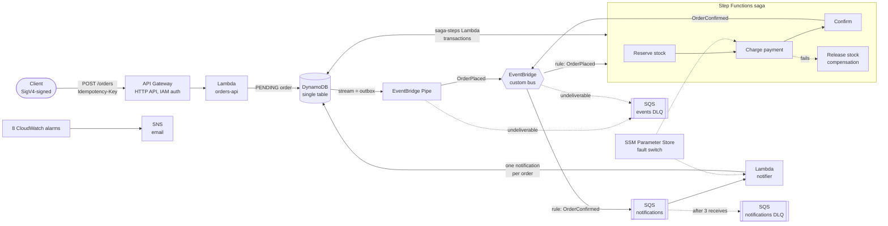

# aws-event-driven-orders

Event-driven order processing on AWS serverless, built with Terraform.

> **Status:** M5 in progress: the load test is done, the cost per order follows
> once the AWS bill shows it. Every number below is measured.

## What it does

A client places an order through an HTTP API. A saga then reserves stock,
charges a simulated payment and confirms the order, or undoes the earlier
steps when one fails. The focus is on the failure paths that tutorials skip:

- **Duplicate requests and deliveries**: an `Idempotency-Key` on the API and
  idempotent consumers, so retries never create a second order or charge.
- **Partial failures**: SQS partial batch responses, dead-letter queues and a
  redrive script.
- **Compensation**: a Step Functions saga that rolls back reserved stock when
  payment fails.
- **Proof**: fault-injection tests, a load test and the real cost per million
  orders, taken from the AWS bill.

## Architecture



Solid arrows are the order path; dotted arrows are failure paths and the
fault-injection switch. The alarms watch the dead-letter queues, the
notification backlog, failed executions, pipe failures, API 5xx, notifier
errors and Lambda throttles.

| Layer | Services |
|---|---|
| API | API Gateway HTTP API, Lambda (Python 3.13, Powertools) |
| State | DynamoDB (single table, on-demand) |
| Events | DynamoDB Streams, EventBridge Pipes, EventBridge custom bus |
| Workflow | Step Functions (saga with compensation) |
| Messaging | SQS with dead-letter queues |
| Observability | CloudWatch Logs, metrics (EMF), alarms, dashboard; X-Ray |
| Delivery | Terraform, GitHub Actions with OIDC (no long-lived keys) |

## Milestones

| | Milestone | Status |
|---|---|---|
| M0 | Repository bootstrap: layout, ADRs, lint and security scans in CI | done |
| M1 | Terraform foundation: S3 state, OIDC deploy role, plan on pull requests | done |
| M2 | Synchronous API with idempotency | done |
| M3 | Event flow and saga | done |
| M4 | Fault injection, integration tests, observability | done |
| M5 | Load test, measured cost, final write-up | in progress |

## The API

Both routes need a SigV4-signed request (IAM authorisation, see ADR 4).

| Request | Result |
|---|---|
| `POST /orders` with `Idempotency-Key` and `{"customer_id": "c-1", "items": [{"sku": "SKU-1", "quantity": 2}]}` | `201` with the order and a `Location` header |
| The same request again (same key, same body) | `201` with the same order; nothing new is stored |
| Same key, different body | `422` |
| No key, or a malformed body | `400` |
| `GET /orders/{order_id}` | `200`, or `404` if it does not exist |
| Any unsigned request | `403` from API Gateway; Lambda never runs |

## How an order flows

1. `POST /orders` stores the order as `PENDING`. That is the only write the API makes.
2. The table's stream feeds an EventBridge Pipe, which publishes `OrderPlaced` to the
   `aedo-dev-orders` bus. The stream acts as an outbox: no order is saved without its event.
3. A rule starts the order saga (Step Functions):
   - **Reserve stock**: a DynamoDB transaction takes the stock and marks the order `RESERVED`,
     or the order is rejected as `OUT_OF_STOCK` if any item is short.
   - **Charge payment** (simulated; customers whose ID starts with `declined` are declined).
   - **Confirm**, then publish `OrderConfirmed`.
   - If payment fails, **release the stock** (compensation) and reject the order.
4. `OrderConfirmed` goes to an SQS queue; the notifier records one notification per order.
   Bad messages fail on their own and reach a dead-letter queue after three receives.

Every step is idempotent, so retries and duplicate events are safe (ADR 5).

## When something fails

| Failure | Where it ends up |
|---|---|
| A notification fails three times | `aedo-dev-notifications-dlq`; `scripts/redrive_dlq.sh` moves it back |
| The pipe or a rule cannot deliver an event | `aedo-dev-events-dlq`, instead of being dropped |
| A saga step fails | retried by Step Functions; a failed execution can be redriven from the failed step |

Eight CloudWatch alarms watch these paths (dead-letter queues, notification
backlog, failed executions, pipe failures, API 5xx, notifier errors, Lambda
throttles), and the `aedo-dev-orders` dashboard follows an order from the API
to its notification. The [runbook](docs/runbook.md) says what to do for each
alarm.

### Fault injection

A switch in Parameter Store (`/aedo-dev/faults`) makes the payment provider
fail a share of calls and the notifier fail a share of messages, without a
deploy. `scripts/fault_experiment.py` turns it on, places orders and checks
the outcome. Two runs of 20 orders, with both faults at 50% (ADR 7):

| | Run 1 | Run 2 |
|---|---|---|
| Confirmed, of which after 1 to 3 failed charge attempts | 18, 6 | 20, 7 |
| Rejected as `PAYMENT_FAILED` (all 4 attempts failed), stock given back | 2 | 0 |
| Saga executions that failed | 0 | 0 |
| Notified on the 1st / 2nd / 3rd delivery | 7 / 7 / 3 | 10 / 6 / 3 |
| Dead-lettered, then delivered after a redrive | 1 | 1 |

Stock taken matched the confirmed orders in both runs, and no order was
notified twice.

### Timings

Measured with `scripts/e2e_saga.py`, which polls every 0.25 s:

- A confirmed order reaches its final status 0.7 to 1.2 s after the API returns
  `201` (five runs), and 1.7 s on the first run after a deploy, when every
  function starts cold.
- The notification follows 0.5 to 0.8 s after `OrderConfirmed` (three runs).
  It was 11 to 21 s until the notification queue's batching window was
  removed (ADR 6).

### Load test

`scripts/load/orders.js` (k6) places signed orders at 5, 10 and 20 a second,
2 minutes per step; `scripts/load_check.py` then checks every order
([procedure](docs/load-test.md), [ADR 8](docs/adr/0008-load-test-and-concurrency.md)).
Run 3, with 4,201 orders:

| | Result |
|---|---|
| Orders confirmed | 4,201 of 4,201 |
| Stock taken | equal to the confirmed quantity, for each of 5 products |
| Notifications | 4,201, all on the first delivery |
| Failed saga executions, dead-lettered messages, throttles, 5xx | 0 |
| API latency p50 / p95 / p99 (k6, client side) | 103 / 171 / 251 ms |
| Saga duration p50 / p95 / p99 | 365 / 470 / 1,467 ms |
| Notification p50 / p95 / p99, from `OrderConfirmed` | 0.62 / 1.08 / 1.15 s |
| Peak concurrent Lambda executions | 17 |

The first run found a bug the unit tests could not: at 20 orders a second,
two reservations sometimes update the same stock item at once, and DynamoDB
cancels one with a `TransactionConflict`. The saga treated that as "out of
stock" and rejected 106 orders with plenty of stock; compensation would have
skipped releasing stock the same way. Conflicts are now retried (117 in run 3,
all confirmed). The first two runs also hit the account's limit of 10
concurrent Lambda executions; after AWS raised it to 1,000, each function got
its own reserved concurrency and the throttling went away.

### Alarm notifications

The alarms notify the SNS topic `aedo-dev-alarms`. Subscribe an address by
hand, so it never goes into the repository or the Terraform state:

```bash
account=$(aws sts get-caller-identity --query Account --output text)
aws sns subscribe --region eu-west-1 --protocol email   --topic-arn "arn:aws:sns:eu-west-1:${account}:aedo-dev-alarms"   --notification-endpoint you@example.org   # replace with your address
```

## Repository layout

```
infra/account/      GitHub roles and permissions boundary (applied by an admin)
infra/envs/<env>/   Terraform root module per environment (applied by CI)
infra/modules/      Terraform modules: data, api, events, function, observability
src/orders_api/     API handler (Python 3.13, Powertools)
src/saga/           saga steps called by Step Functions
src/notifier/       SQS consumer for OrderConfirmed
tests/unit/         unit tests: the real handler against DynamoDB mocked by moto
docs/adr/           architecture decision records
docs/runbook.md     what to do when each alarm fires
docs/load-test.md   how to run the load test and check the result
docs/load-results/  output of the three load-test runs in ADR 8
scripts/            lint, state bootstrap, account apply and destroy
scripts/load/       k6 load test; see docs/load-test.md
```

## Running the checks locally

Needs Terraform 1.10+, Python 3.13 and optionally TFLint and ShellCheck.

```bash
pip install --user -r scripts/requirements-lint.txt
bash scripts/lint.sh

python -m venv .venv && .venv/bin/pip install -r requirements-dev.txt
.venv/bin/python -m pytest
```

After a deploy (the endpoint is the `api_endpoint` Terraform output):

```bash
python scripts/smoke_api.py <api-endpoint>    # API checks with signed requests
python scripts/seed_stock.py                  # 100 units of SKU-1 to SKU-5
python scripts/e2e_saga.py <api-endpoint>     # happy, declined and out-of-stock orders
python scripts/fault_experiment.py <api-endpoint>   # needs an administrator profile
bash scripts/redrive_dlq.sh                   # move dead-lettered notifications back
```

These use the default AWS credential chain. Credentials from `aws login` need
the optional `botocore[crt]` package; without it, export temporary credentials
first: `eval "$(aws configure export-credentials --format env)"`.

Locally, a missing linter is skipped with a warning. In CI every linter is
required.

## Deploying

Needs the AWS CLI and an administrator profile for the one-off steps.

```bash
export AWS_PROFILE=<admin profile>
bash scripts/bootstrap-state.sh   # once per account: the state bucket
bash scripts/account.sh apply     # GitHub roles and permissions boundary
```

After that, GitHub Actions does the rest: every pull request that touches
`infra/` gets a plan summary as a comment, and merging to `main` applies dev
through the `dev` environment, then runs the smoke test and the end-to-end
test against it with a role that can only call the API and read orders. The repository needs one secret,
`AWS_ACCOUNT_ID`.

To remove everything: `bash scripts/destroy.sh --all` (dev, the account module,
then the state bucket with every version in it). Without `--all` it removes dev
only.

## Decisions

- [ADR 1: Terraform for infrastructure](docs/adr/0001-terraform-for-infrastructure.md)
- [ADR 2: Python for the Lambda handlers](docs/adr/0002-python-lambda-handlers.md)
- [ADR 3: Terraform state and GitHub access to AWS](docs/adr/0003-state-and-github-access.md)
- [ADR 4: IAM authorisation on the HTTP API](docs/adr/0004-iam-auth-on-the-api.md)
- [ADR 5: Event flow and order saga](docs/adr/0005-event-flow-and-saga.md)
- [ADR 6: Alarms, dashboard and dead-letter queues](docs/adr/0006-alarms-and-dead-letters.md)
- [ADR 7: Fault injection and post-deploy tests](docs/adr/0007-fault-injection-and-post-deploy-tests.md)
- [ADR 8: Load test, stock contention and concurrency](docs/adr/0008-load-test-and-concurrency.md)

## Licence

[MIT](LICENSE)
